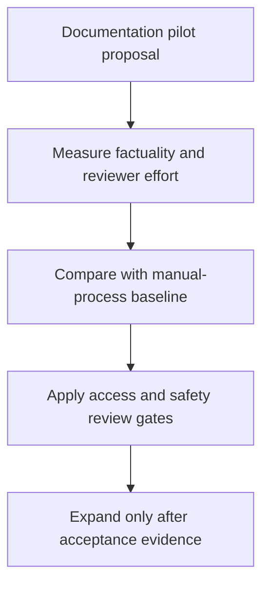

# Generative AI Adoption Roadmap

Translate an enterprise generative-AI opportunity into a staged implementation proposal with explicit governance and evaluation gates.

## Implementation

A strategy case covering use-case selection, implementation phases, stakeholders, risk controls, success measures, and investment assumptions.



## Worked decision

Read the [release-gate scenario](examples/worked-scenario.md): a fluent documentation pilot cannot expand until factuality, reviewer effort and access controls have been measured. This repository is a strategy artifact, so the example applies its existing gates to hypothetical inputs. It is not an implemented agent or an achieved business result.

## Evidence and results

The repository contains a structured strategy brief recovered from the completed presentation. Targets and financial figures are proposal assumptions, not measured client outcomes.

See [VALIDATION.md](VALIDATION.md) for the release checks and their scope.

## Run locally

Read the [strategy brief](STRATEGY.md) and [worked decision](examples/worked-scenario.md).

The strategy is a written proposal. Check its source files with:

```sh
python scripts/validate_source.py
```

## Limitations

This is a strategy case study, not an implemented software service or evidence of a client engagement. Assumptions need current operational and financial validation before investment.
