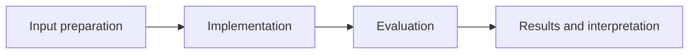

# Generative AI Adoption Roadmap

**Feras Elghandour** · Technical case study

Translate an enterprise generative-AI opportunity into a staged implementation proposal with explicit governance and evaluation gates.

## Implementation

A strategy case covering use-case selection, implementation phases, stakeholders, risk controls, success measures, and investment assumptions.



## Evidence and results

The repository contains a structured strategy brief recovered from the completed presentation. Targets and financial figures are proposal assumptions, not measured client outcomes.

Results described as saved come from the retained experiment record. See [VALIDATION.md](VALIDATION.md) for the checks performed on this release and their scope.

## Practical relevance

This project demonstrates a strategy case covering use-case selection, implementation phases, stakeholders, risk controls, success measures, and investment assumptions.
The implementation and evaluation make the trade-offs inspectable for technical review.

## Run locally

```sh
Read STRATEGY.md
```

Prepare the inputs described in [DATA.md](DATA.md) first. Source validation is available without installing model dependencies:

```sh
python scripts/validate_source.py
```

## Limitations

This is a strategy case study, not an implemented software service or evidence of a client engagement. Assumptions need current operational and financial validation before investment.

## Development

Changes should include a clear description of the behavior affected and verification appropriate to that behavior. Keep input data, credentials, model caches, and generated artifacts outside version control.
